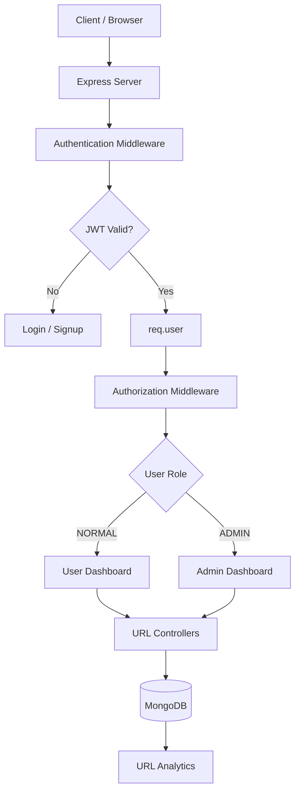

# 🔗 Custom URL Shortener with Authentication & Authorization

<div align="center">

### 🚀 Transform Long URLs into Short Links

A backend project built with Node.js, Express.js, MongoDB and JWT Authentication.

<p>


</p>

</div>

---

## 📌 About The Project

This project is a **Custom URL Shortener** that allows users to convert long URLs into short, shareable links.

It also includes a complete authentication and authorization system using **JWT, Cookies, Express Middleware and Role-Based Access Control (RBAC)**.

Users can generate short URLs, track link visits, and view analytics through their dashboard. Admin users have additional privileges to access and manage URL records.

## ✨ Features

### 🔗 URL Shortening
- Generate unique short URLs using Short ID.
- Redirect short URLs to original destinations.
- Store URL records in MongoDB.
- Track individual URL visits.
- Maintain visit history with timestamps.
- Calculate total clicks.

### 🔐 Authentication
- User Signup and Login.
- JWT-based authentication.
- Cookie-based token storage.
- Authentication middleware.
- JWT verification for user identification.
- Protected routes.

### 🛡️ Authorization & RBAC
- Role-Based Access Control.
- Two user roles: `NORMAL` and `ADMIN`.
- Custom authorization middleware.
- Closure-based `restrictTo()` function.
- Restrict access based on user roles.
- Admin-specific routes and dashboard.

### 📊 URL Analytics
- Track individual link visits.
- Store timestamps for every visit.
- Calculate total clicks.
- Retrieve analytics using a dedicated API endpoint.

### 🖥️ Dashboard
- Dynamic pages using EJS.
- User-specific URL dashboard.
- Admin dashboard.
- Login and Signup pages.

---

## 🧰 Tech Stack

| Technology | Purpose |
|---|---|
| 🟢 Node.js | JavaScript Runtime |
| ⚡ Express.js | Backend Framework |
| 🍃 MongoDB | Database |
| ODM Mongoose | Database Modeling |
| 🔑 JWT | Authentication |
| 🍪 Cookie Parser | Cookie Management |
| 🎨 EJS | Server-Side Rendering |
| 🔗 Short ID | Unique URL Generation |
| 💻 JavaScript | Backend Logic |

---

## 🏗️ Application Architecture



---

## 🔄 Authentication Flow

1. User registers through the Signup page.
2. User logs in using email and password.
3. Server verifies the credentials.
4. JWT token is generated.
5. Token is stored in a browser cookie.
6. Authentication middleware extracts the token.
7. JWT is verified using the secret key.
8. Decoded user information is attached to `req.user`.
9. Authorization middleware checks the user's role.

## 🛡️ Role-Based Authorization

The project uses a closure-based `restrictTo()` middleware.

```javascript
function restrictTo(roles = []) {
    return function(req, res, next) {

        if (!req.user) {
            return res.redirect("/login");
        }

        if (!roles.includes(req.user.role)) {
            return res.end("Unauthorized");
        }

        return next();
    };
}
```

The middleware allows access only when the authenticated user's role matches the permitted roles.

### 👥 User Roles

| Role | Permissions |
|---|---|
| `NORMAL` | Generate URLs and access personal dashboard |
| `ADMIN` | Access admin dashboard and all URL records |

---

## 📡 Application Routes

| Method | Endpoint | Description |
|---|---|---|
| GET | `/` | User Dashboard |
| GET | `/signup` | Signup Page |
| GET | `/login` | Login Page |
| POST | `/user/` | Register User |
| POST | `/user/login` | User Login |
| POST | `/url/` | Generate Short URL |
| GET | `/url/analytics/:ShortID` | URL Analytics |
| GET | `/admin/urls` | Admin Dashboard |
| GET | `/:ShortID` | Redirect to Original URL |

---

## 📁 Project Structure

```text
urlShortner/
│
├── connections.js
│
├── controllers/
│   ├── url.js
│   └── user.js
│
├── middlewares/
│   └── auth.js
│
├── models/
│   ├── url.js
│   └── user.js
│
├── routes/
│   ├── staticRouter.js
│   ├── url.js
│   └── user.js
│
├── service/
│   └── auth.js
│
├── views/
│   ├── home.ejs
│   ├── login.ejs
│   └── signup.ejs
│
├── index.js
├── package.json
└── README.md
```

---

## ⚙️ Installation & Setup

### 1️⃣ Clone Repository

```bash
git clone https://github.com/kr-deepak17/Custom-url-shortner.git
```

### 2️⃣ Navigate to Project

```bash
cd Custom-url-shortner
```

### 3️⃣ Install Dependencies

```bash
npm install
```

### 4️⃣ Start MongoDB

Make sure MongoDB is running locally.

```text
mongodb://localhost:27017/short-url
```

### 5️⃣ Run the Application

```bash
npm start
```

Open your browser:

```text
http://localhost:8001
```

---

## 🧠 Key Concepts Learned

- REST API Development
- Express.js Routing
- Middleware & Middleware Chaining
- JWT Authentication
- Cookies & Token Management
- Authentication vs Authorization
- Role-Based Access Control (RBAC)
- JavaScript Closures
- MongoDB CRUD Operations
- Mongoose Schemas & Models
- URL Redirection
- Server-Side Rendering with EJS

---

## 🔮 Future Improvements

- [ ] Password Hashing using bcrypt
- [ ] JWT Expiration & Refresh Tokens
- [ ] Secure HTTP-only Cookies
- [ ] Custom URL Aliases
- [ ] URL Expiration Functionality
- [ ] Improved Analytics Dashboard
- [ ] Deployment to Cloud

---

## 👨‍💻 Author

<div align="center">

### Deepak Kumar

B.Tech CSE (AI) | Backend Developer | DSA Enthusiast

<a href="https://github.com/kr-deepak17">

</a>

---

⭐ **If you like this project, don't forget to give it a star!**

*Built with ❤️ using Node.js & Express.js*

</div>
